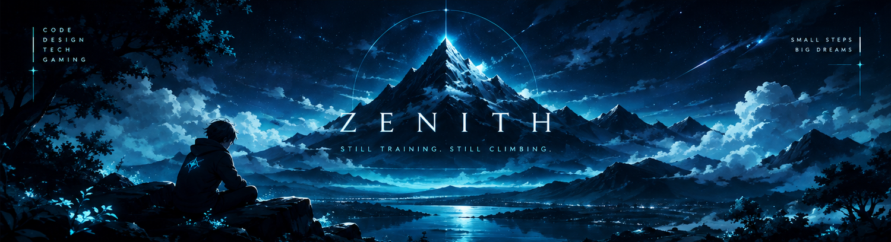

  

# S A M A W I I Z E N I T H

### `BUILDING QUIETLY. IMPROVING CONSTANTLY.`

*Still training. Still climbing.*

---

## `01 / ABOUT`

I'm Samawii — an aspiring developer exploring the
intersection of **code, design, and technology**.

I'm learning by experimenting, building projects,
and improving one step at a time.

> I don't need to know everything today.
> I just need to keep improving.

## `02 / CURRENTLY EXPLORING`

| Area | Focus |
|---|---|
| Programming | Python and problem-solving |
| Web development | HTML, CSS, JavaScript |
| Creative technology | UI design and Blender |
| Tools | VS Code, Git, GitHub |

## `03 / PROJECTS`

*Currently preparing my first projects.*

My goal is to build useful tools, clean interfaces,
and creative experiments as I learn.

## `04 / OUTSIDE THE TERMINAL`

`GAMING` · `ANIME` · `DESIGN` · `CREATIVE TECH`

---

### Z E N I T H

`NO SHORTCUTS // JUST PROGRESS`

